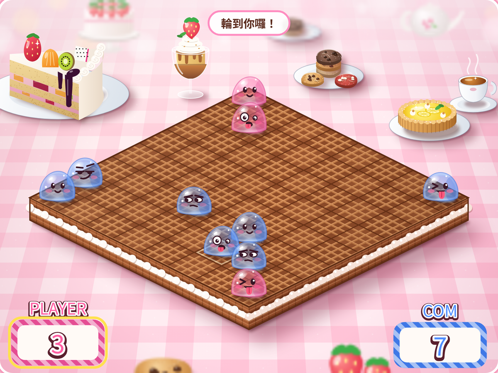

# Q彈搶地盤 Jelly Land Grab

致敬經典 Flash 小遊戲「果凍搶地盤」的同人復刻版。在巧克力威化餅棋盤上搶地盤，把對手的果凍嚇一跳，再把它們染成你的顏色！

A fan-made tribute remake of the classic Flash game "果凍搶地盤" (Jelly Land Grab). Play it right in your browser — no download needed.

## 立即遊玩

👉 **https://jccwen.github.io/jelly-game/**

手機、平板、電腦的瀏覽器都能玩，不用下載、不用安裝。

## 玩法

1. 點一顆你的粉紅果凍，再點一個發亮的格子。
2. **白色亮格（相鄰一格）**：分裂出一顆新果凍，原本的也留著。
3. **黃色虛線（隔一格）**：整顆跳過去，原位置會空出來。
4. 落地後，周圍八格的對手果凍會全部變成你的顏色。
5. 沒地方走會自動 PASS；棋盤填滿或一方被吃光時，果凍多的人贏。

## 特色

- 8×8 斜角威化餅棋盤，側面看得到奶油夾心
- 半透明、會晃動的 Q 彈果凍，配上一堆欠揍表情和對話泡泡
- 電腦對手三種難度，也能雙人同機對戰
- 4 張地圖、悔棋、依連吃數變化的 COMBO 特效
- 自製 8-bit 背景音樂和音效，可分別開關
- 遊戲結束可產生戰績卡（含最終棋盤），分享到 LINE、Threads、Facebook

## 意見回饋

發現問題或有建議，歡迎到這個 repo 開 [Issue](../../issues)。

## 致敬與說明

這是一款**同人復刻作品**，向早年在 360 遊戲大廳等網站上流傳的 Flash 小遊戲「果凍搶地盤」致敬。玩法（同化棋規則）、果凍與甜點的主題，以及畫面安排都參考自原作。

- 本作的程式碼、圖案、背景音樂和音效都是**重新製作**的，沒有使用原作的任何圖片、聲音或程式。
- 本作與原作及其作者、發行商**沒有任何關係**，也不是官方版本。
- 如果你是原作的作者或權利人，對本作有任何疑慮，歡迎開 Issue 聯絡，我會盡快處理或下架。

## 版權

© 2026 Q彈搶地盤 Jelly Land Grab. All rights reserved.
本頁面僅供線上遊玩，未經授權不得複製、修改或散布遊戲內容。
